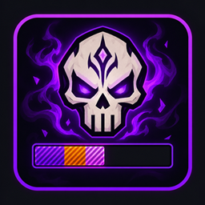
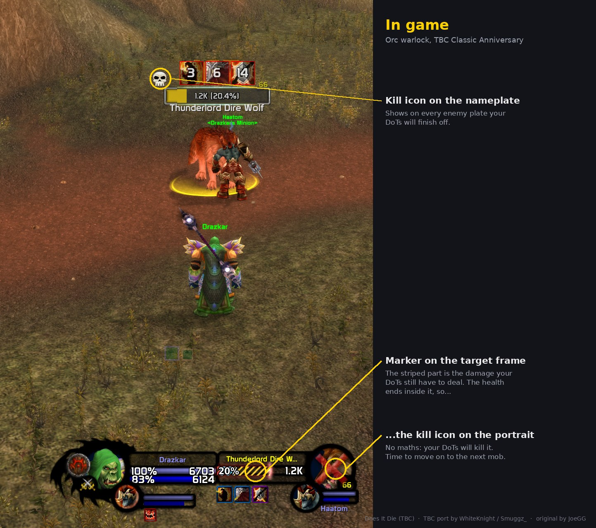
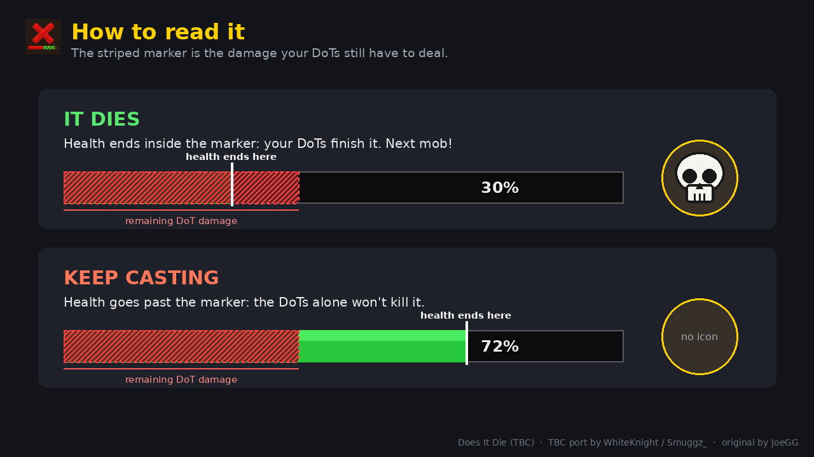
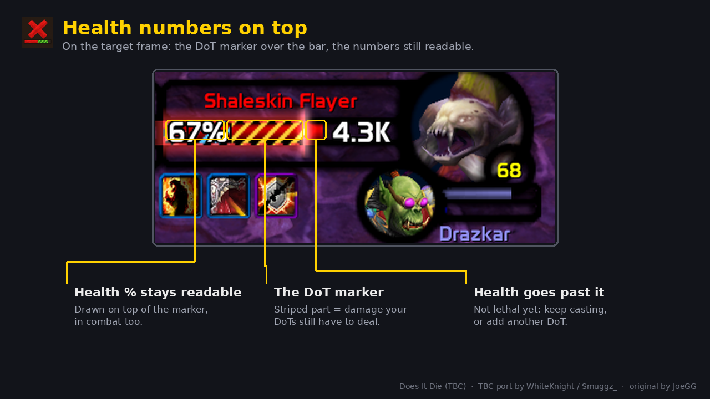
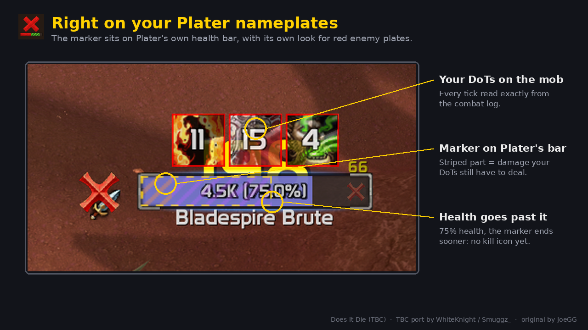
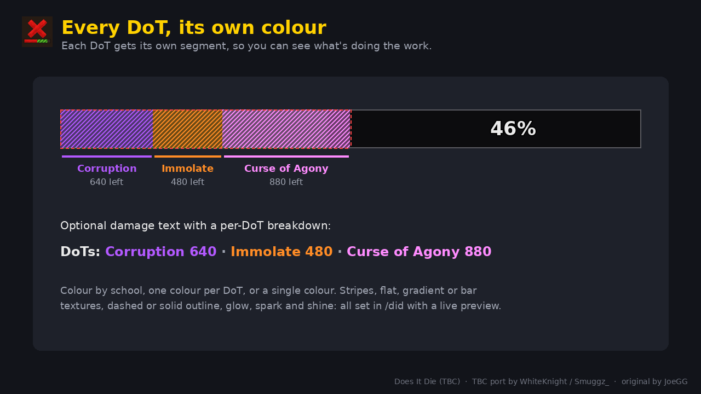
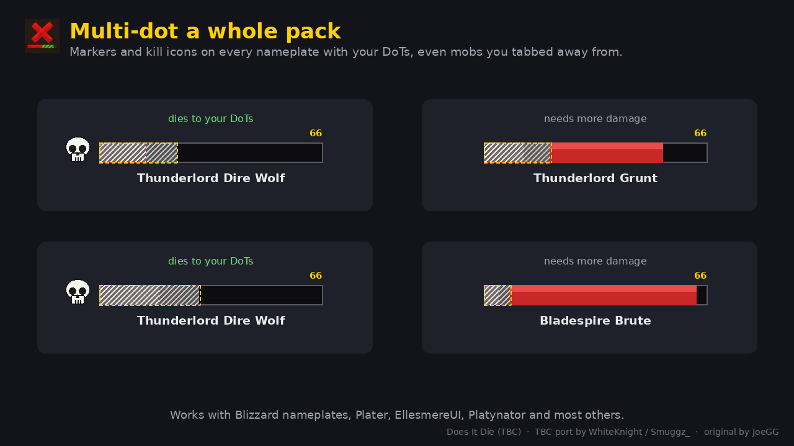
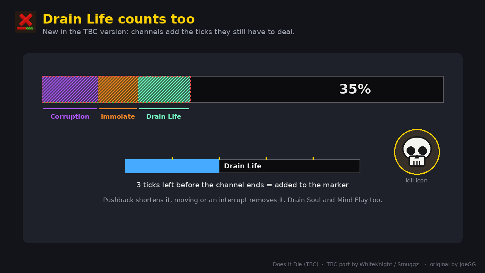

<p align="center">
  
</p>

<h1 align="center">Does It Die (TBC &amp; Classic Era)</h1>

<p align="center">
  <strong>Stop wasting casts on mobs that are already dead.</strong><br>
  See, right on your target frame and nameplates, whether your DoTs will finish the job.
</p>

<p align="center">
  
  
  
  
  
</p>

<p align="center">
  
</p>

---

## Contents

- [What it does](#what-it-does)
- [What's new in the TBC version](#whats-new-in-the-tbc-version)
- [Screenshots](#screenshots)
- [Installation](#installation)
- [Commands](#commands)
- [Supported DoTs](#supported-dots)
- [How accurate is it?](#how-accurate-is-it)
- [PvP](#pvp)
- [Classic Era](#classic-era)
- [Compatibility](#compatibility)
- [Bug reports](#bug-reports)
- [Development](#development)
- [Credits and licence](#credits-and-licence)

## What it does

| | |
|---|---|
| **Damage marker** | A striped section on your target's health bar covers the damage your DoTs still have to deal. If the health ends inside the marker, the mob is going to die. |
| **Kill icon** | When your DoTs are enough to kill the target, a skull (or red X, tick or sunglasses) appears on its portrait. |
| **Nameplates** | The same marker and a small kill icon on every enemy nameplate with your DoTs on it. Made for multi-dotting. |
| **Focus frame** | The marker on your focus's health bar, and `/cast [@focus]` DoTs are tracked on the right mob (TBC). |
| **Per-DoT colours** | Each DoT gets its own segment, so you can see Corruption, Immolate and Agony separately. |
| **Fully customisable** | `/did` opens an options window with a live preview: icons, fills, outlines, animations and text. |

<p align="center">
  
</p>

## What's new in the TBC version

The original addon was built for WoW: Forever, which hides most combat information from addons, so it had to estimate which hits were DoT ticks. TBC has no such restrictions, so this version reads things directly.

- **Exact tracking from the combat log.** Every tick, miss, resist, dispel and death is read by spell name, on every mob, including ones you've tabbed away from.
- **Health numbers stay readable.** A copy of your target frame's health text is drawn on top of the marker. Works with Blizzard's frame, BetterBlizzFrames and other unit frame addons, in combat too.
- **Channels count.** Drain Life, Drain Soul and Mind Flay add the ticks they still have to deal, pushback included.
- **Spell power and attack power** are read at cast time, so trinket procs and flasks are reflected.
- **Curse of Agony modelled correctly.** The base damage ramps up; the spell power bonus is spread evenly over every tick.
- **No false kill icons.** Before a DoT's first tick the estimate is cautious (the lowest of your last 5 casts); from the first tick, that DoT's real ticks take over.
- **One download for TBC Anniversary and Classic Era.** See [Classic Era](#classic-era).
- **Works in PvP.** The game only reports enemy players' health as a percentage, so their real health is worked out from the damage they take. The marker appears after a few hits and is remembered per player. Can be switched off.
- **Plater support**, plus automatic detection of other nameplate addons' health bars.
- **Real combo points** for Rip and Rupture, and DoT timing that starts when the debuff lands.

## Screenshots

<table>
  <tr>
    <td width="50%"><br><sub><b>Health numbers on top.</b> The marker sits over the bar and the percentage stays readable.</sub></td>
    <td width="50%"><br><sub><b>Plater nameplates.</b> The marker sits on Plater's own health bar.</sub></td>
  </tr>
  <tr>
    <td width="50%"><br><sub><b>Every DoT, its own colour,</b> with an optional per-DoT damage breakdown.</sub></td>
    <td width="50%"><br><sub><b>Multi-dot a pack.</b> Markers and kill icons on every plate with your DoTs.</sub></td>
  </tr>
  <tr>
    <td width="50%"><br><sub><b>Drain Life counts too.</b> Channels add the ticks they still have to deal.</sub></td>
    <td width="50%"><br><sub><b>How to read it.</b> Health inside the marker means it dies.</sub></td>
  </tr>
</table>

## Installation

**CurseForge app:** search for **Does It Die (TBC)** and click Install.

**Manually:**

1. Download the latest version from the [Releases](../../releases) page, or this repository as a zip (**Code → Download ZIP**).
2. Copy the `DoesItDie` folder into `World of Warcraft\_anniversary_\Interface\AddOns\` (TBC Anniversary) or `World of Warcraft\_classic_era_\Interface\AddOns\` (Classic Era).
3. Restart the game and type `/did` to open the options.

If the addon shows as out of date, tick **Load out of date AddOns** on the character selection screen.

## Commands

| Command | What it does |
|---|---|
| `/did` | Open the options window (live preview) |
| `/did accuracy` | Predicted vs real damage for your last DoTs |
| `/did channels` | Turn Drain Life / Drain Soul / Mind Flay prediction on or off |
| `/did pvp` | Show or hide the marker and kill icon on enemy players |
| `/did text` | Put the health numbers above or below the marker |
| `/did textcheck` | List the text over your target's health bar (for bug reports) |
| `/did skull` | Show the kill icon for 5 seconds to check its position |
| `/did ticks` | What each DoT really ticks for, compared with its tooltip |
| `/did reset` | Forget learned tick sizes |
| `/did debug` | Echo the tracking log to chat |

## Supported DoTs

| Class | Spells |
|---|---|
| **Warlock** | Corruption, Immolate, Curse of Agony, Unstable Affliction\*, Siphon Life, Seed of Corruption\*, *Drain Life and Drain Soul (while channelling)* |
| **Priest** | Shadow Word: Pain, Vampiric Touch\*, Devouring Plague, Holy Fire, *Mind Flay (while channelling)* |
| **Druid** | Moonfire, Insect Swarm, Entangling Roots, Rake, Rip, Pounce, Lacerate\* |
| **Hunter** | Serpent Sting, Immolation Trap |
| **Mage** | Fireball and Pyroblast (their damage-over-time part) |
| **Rogue** | Rupture, Garrote |
| **Shaman** | Flame Shock |
| **Warrior** | Rend |

\* TBC only; these spells don't exist in Classic Era.

Finishers (Rip, Rupture) use the combo points you actually spent.

## How accurate is it?

The addon learns from your **real ticks**, so your spell power, spell rank, talents, buffs and debuffs on the mob are all in the numbers, and it remembers them between sessions.

- **Before a DoT's first tick**, the estimate is deliberately cautious: the lowest of your last few casts, scaled to your current spell power. Partial resists and debuffs on a mob can't be known until it ticks.
- **From the first tick on**, that DoT is predicted from its own real ticks.
- `/did accuracy` shows predicted vs real damage for your last DoTs, including anything the mob resisted.

## PvP

The game only tells addons an enemy player's health as a percentage, not in hit points. Does It Die works out their real health by adding up all the damage and healing they take in the combat log (from everyone, not just you) and comparing it with how far their percentage moves: 1,200 damage moving them from 80% to 70% means about 12,000 health.

- On a new player, chat says it's measuring, and the marker appears once they've lost about 8% of their health.
- The size is remembered per player name, so the next fight with the same player shows the marker straight away.
- Your ticks on players (reduced by resilience) are learned separately, so PvP never changes your PvE estimates.
- Players can heal, drink potions and use immunities, so in PvP the kill icon is a hint, not a promise.
- Turn it off with `/did pvp` or **Advanced → Show on enemy players**.

## Classic Era

The same download works on Classic Era (including Hardcore). Both games run on the same modern Classic client, so everything above works the same way there: combat log tracking, channels, spell power, nameplates, Plater, the health text copy and PvP.

- Spells that only exist in TBC (Unstable Affliction, Seed of Corruption, Vampiric Touch, Lacerate) simply never show up.
- Vanilla tooltip wording is read, including "every second" for Drain Life.
- Classic Era has no Blizzard focus frame, so the focus marker only appears if a unit frame addon provides one.
- Season of Discovery rune DoTs aren't specifically supported yet.

## Compatibility

| | |
|---|---|
| **Client** | TBC Classic Anniversary (2.5.5, 2.5.6) and Classic Era (1.15.7 to 1.15.9) |
| **Target frames** | Blizzard, BetterBlizzFrames, EllesmereUI, and others via **Advanced → custom frame path** |
| **Nameplates** | Blizzard, Plater, EllesmereUI, Platynator, and most others automatically |

**Known limitations:** only your own DoTs are tracked; on enemy players the marker waits until their health has been measured; proc DoTs with no cast (Deep Wounds, Ignite, poisons) aren't tracked; healing on the target isn't accounted for; Curse of Doom isn't a DoT, so it isn't shown.

## Bug reports

Please [open an issue](../../issues/new/choose) and include:

- your class and the spell involved;
- which unit frame and nameplate addons you use;
- the output of `/did debug` from the fight, or `/did textcheck` for display problems.

## Development

`tests/tbc_test.lua` loads every addon file in a fake WoW environment set up like the TBC client and plays scripted fights through the combat log: tick tracking, misses and resists, channels, Agony's ramp, spell power scaling, Plater, the health text copy, PvP health measuring, and Classic Era (vanilla) tooltips. It needs a Lua 5.1 interpreter:

```sh
lua tests/tbc_test.lua DoesItDie tests
```

See [CHANGELOG.md](CHANGELOG.md) for the history of the TBC port.

## Credits and licence

- **TBC and Classic Era port:** WhiteKnight / Smuggz_
- **Original addon:** [Does It Die](https://github.com/swirllyman/DoesItDie) by **JoeGG**, made for WoW: Forever. The marker, kill icon, options window and overall design are his work.

Released under the [MIT licence](LICENSE), as the original is.

*World of Warcraft is a trademark of Blizzard Entertainment. This is a fan-made addon, not affiliated with Blizzard.*
